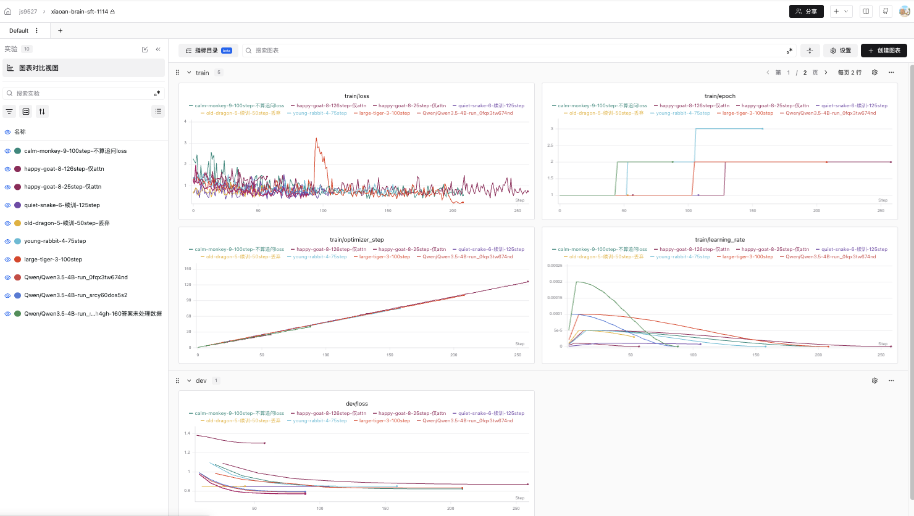
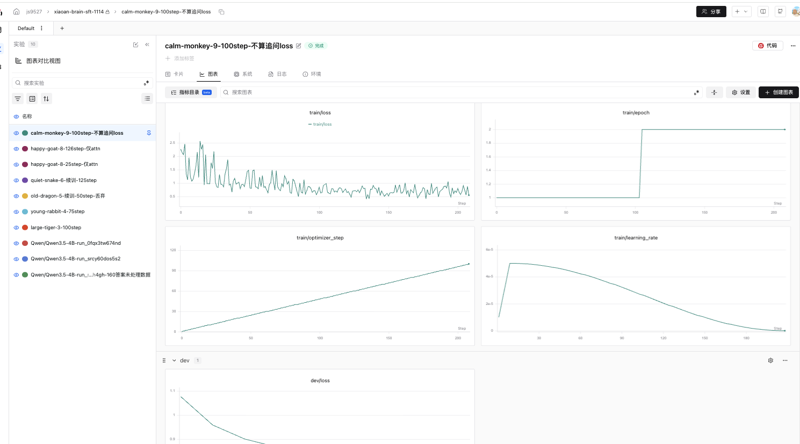

# SFT 消融实验与评测说明

本文档记录小安智库 RAG 知识库在生成侧引入监督微调（SFT）前的评测基线、SFT 数据与训练方案的迭代过程，以及历次消融实验的指标变化与结论。

> 指标说明：本文沿用 RAGAS 评测框架的五项指标——Faithfulness（忠实度）、Answer Relevancy（答案相关性）、Context Precision（上下文精确率）、Context Recall（上下文召回率）、Answer Correctness（答案正确性）。所有百分比均为相对变化，以「SFT 前基线均值」为分母计算；除特别注明外，评测集为标准 hold40 + human20。

---

## 一、SFT 前的评测基线

在引入 SFT 之前，先对检索与提示词做了两轮迭代，得到 SFT 的起点基线。

**第一次 RAGAS 评估（检索与提示词优化前）**

`71.4% / 87.7% / 82.7% / 78.3% / 49.6%`（Faithfulness / Relevancy / Precision / Recall / Correctness）

发现两类问题：

1. **上下文精确率与召回率偏低**（82.7% / 78.3%），在时序、流程依赖类问题上尤其突出。
   - 根因：用户问「1.1 的下一步是什么？」时，向量相似度让问句与 1.1 更贴近，只召回 1.1，漏掉真正的答案 1.2。
   - 解决：切片粒度从 300 放大到 500，并增加切片回填、同章节召回。
   - 结果：精确率 / 召回率从（82.7%, 78.3%）提升到（86.3%, 90%）。

2. **答案正确性偏低**（49.6%）。
   - 根因：提示词对答案表达风格的修饰与参考答案差距较大。
   - 解决：调整生成提示词，使答案表达与参考答案风格对齐。
   - 结果：正确性从 49.6% 提升到 64.4%。

**第二次 RAGAS 评估（准备 SFT 数据时）**

`81.0% / 90.8% / 85.6% / 84.0% / 62.2%`

结论：检索已无明显瓶颈（Recall 84.0%），但 Faithfulness（81.0%）与 Answer Correctness（62.2%）难以继续靠提示词优化提升。问题不在「知识」（检索上下文已经给到），而在「回答方式」——因此引入 SFT 做指令对齐，用 `(问题, 检索上下文) → 有据答案` 的格式对，训练模型「引用而非编造」。

---

## 二、SFT 训练与消融实验迭代

从第二次评估的基线出发，共进行了四轮训练方案调整与六组消融对比。各组实验的定义如下：

| 实验 | 训练配置 | 评估配置 | 评测集口径 |
|---|---|---|---|
| 01 | attn+mlp+lm，未清洗答案数据 | 标准 | 旧集 hold20+human10 |
| 02 | attn+mlp+lm，清洗后答案 | 标准 | hold40+human20 |
| 03 | 仅 attn | 标准 | human20（缺 hold 后评估）|
| 04 | 仅 attn | 修改推理提示词 | hold40+human20 |
| 05 | 仅 attn | 修改推理提示词 + 追问建议后不做评估 | hold40（无 human）|
| 06 | 仅 attn，+20% 拒绝回答负样本，追问建议不算 loss | 修改推理提示词 + 追问建议后不做评估 | hold40+human20 |

> 口径提示：02 / 04 / 06 为完整标准评测集，可横向对比；01 使用旧评测集、03 缺 hold 后评估、05 仅 hold，三者仅作过程参考，不参与最终结论的横向比较。

### 训练过程监控

各轮 SFT 训练均通过 SwanLab 实时监控，下图为多组实验的训练曲线对比（train / dev 的 loss、epoch、optimizer_step、learning_rate）：



最终方案（仅 attn + 追问建议不计 loss，run `calm-monkey-9-100step-不算追问loss`）的训练指标面板如下，train/loss 与 dev/loss 均随训练步数收敛：



> 指标对比报告（完整 HTML 版，含各指标跨实验折线图与相邻实验后值差标注）见 [`SFT消融实验指标对比报告.html`](SFT消融实验指标对比报告.html)。

### 实验 01：attn+mlp+lm，未清洗数据

- 结果：忠实度 **+7.30%**，相关性 **−8.76%**，正确性 +6.75%。
- 现象：RAGAS 对「极简但正确」的答案打低分——回答只准确、不完整，且训练数据未清洗。
- 根因：参考答案过短；答案提示词只要求「准确」，未要求「完整句 + 点题 + 结构」。数据侧提问粒度过细（填空题化），与「只求准确、不求完整句」的提示词叠加，产生约 20% 的裸词答案，带偏了微调。
- 处理：清洗数据，改写数据生成提示词，统一推理侧提示词的 input / 答案、评测数据与黄金数据集，随后进入实验 02。

### 实验 02：attn+mlp+lm，清洗后答案

- 结果：对比实验 01，相关性 **+13.89%**；忠实度 **−24.74%**（相邻实验后值对比）。对比 SFT 前基线，忠实度 −15.12%、相关性 −0.88%，出现「跷跷板」现象。
- 根因（三点）：
  1. SFT 不适合学习新知识，会引入「合理推断类幻觉」——这类幻觉不跑题，所以相关性不受影响，只适合指令对齐。
  2. 约束文本过拟合、指令模板未脱敏：输入提示词前缀相同、样本未多样化，模型未理解语义规则，只把这段文字当成固定模板前缀、背景噪声 token。
  3. 把固定不变的忠实约束文本（如「根据事实作答，禁止编造」）大批量塞进每条 SFT 输入一起训练。
- 处理：
  1. attn 适合学格式、mlp 适合学内容，多学 mlp 会覆盖原有知识，因此改为仅 attn 的 LoRA 微调（实验 03）。
  2. 采用自蒸馏：既要学格式又不遗忘事实，由一轮 LLM 当老师，训练时加 KL 散度正则项。

### 实验 03：仅 attn

- 结果：对比实验 02，忠实度 +8.66%、相关性 −3.30%。对比 SFT 前基线，忠实度 −16.29%、相关性 +2.51%，仍呈跷跷板。
- 根因（两点）：
  1. 数据中的【追问建议】使评估召回上下文 / 正文（包含追问建议）被计入，造成幻觉误判。但从业务角度，训练数据与产品语义本身是对的（追问本就该自由推测），问题在于评测把追问和正文混在一起打分。
  2. SFT 接触新事实信息会显著增加相对于预训练知识的幻觉，机制是「事实性遗忘」——模型学习新任务格式时，参数更新干扰到预训练阶段已掌握的事实表征。
- 处理：暂先修改推理提示词进行评测（实验 04）。

### 实验 04：仅 attn，修改推理提示词

- 结果：对比未改提示词，忠实度 −9.51%、相关性 +4.79%。对比 SFT 前基线，忠实度 −16.54%、相关性 +0.44%，仍呈跷跷板。
- 根因：同实验 03，核心仍是【追问建议】被混入评测打分。
- 处理：评测侧对追问建议后的内容不做评估（实验 05）。

### 实验 05：仅 attn，评估不做追问建议评估

- 结果：对比未改提示词，忠实度 **+34.32%**、正确性 **+15.87%**，相关性 −1.11%，但召回率 −14.87%。
- 说明：本组仅 hold40 口径，且召回率下降较大，故仅作过程结论——确认「追问建议」是幻觉误判的主因。

### 实验 06（最终方案）：仅 attn + 20% 拒绝回答负样本 + 追问建议不算 loss

- 训练改动：加入 label masking，对【追问建议】部分的 weight 置 0、不参与 loss 计算；同时补充 20% 拒绝回答负样本。
- 评估配置：修改推理提示词 + 追问建议后不做评估。
- 结果（对比 SFT 前基线）：
  - 忠实度 **+10.41%**
  - 答案正确性 **+14.96%**
  - 相关性 +1.32%，召回率 +1.71%，均未明显损失

---

## 三、总体结论

从最初的 `71.4% / 87.7% / 82.7% / 78.3% / 49.6%`，
到 SFT 前基线 `81.0% / 90.8% / 85.6% / 84.0% / 62.2%`，
再到最终 SFT 后 `89.5% / 92.0% / 83.5% / 85.4% / 71.5%`，三项关键指标（忠实度、相关性、正确性）均有提升。

核心结论如下：

1. **SFT 管行为、不管知识。** 微调无法弥补知识缺口，召回率与精确率的提升应依赖 RAG 索引与检索阶段的优化；过度训练反而可能引入「事实性遗忘」型幻觉。SFT 只负责指令对齐与回答风格。
2. **训练数据必须与评测口径严格对齐。** 【追问建议】在业务上合理，但混入评测会系统性抬高幻觉误判。最终通过「训练侧 label masking（追问不计 loss）+ 评测侧不做追问评估」双管齐下解决。
3. **仅微调 attention 层优于 attn+mlp+lm。** attn 学格式、mlp 学内容，全量微调 mlp 会覆盖预训练事实，仅 attn 的 LoRA 更稳。
4. **拒绝样本与负样本是忠实度的重要补充。** 20% 拒绝回答负样本帮助模型学会「参考未说明即明确拒绝」，抑制编造。

> 需要说明：实验 05（仅 hold 口径）虽然忠实度提升最大（+34.32%），但伴随召回率明显下降（−14.87%），且口径不完整，故不作为最终方案。最终方案 06 在忠实度与正确性上取得确定性提升的同时，未牺牲相关性与召回率，是综合最优配置。

## 四、SFT 训练参数参考

### 数据情况

| 数据集 | 样本量 | 说明 |
|---|---|---|
| 训练样本 | 600 条 | 根据上传文档生成问题与答案（含拒绝样本和负样本），由 gpt-6-sol 蒸馏生成 |
| 验证样本 | 72 条 | 同上 |
| 测试样本 | 40 条 | 同上 |
| 黄金集样本 | 20 条 | 手工根据文档生成（含拒绝样本和负样本）|

### 基础模型与微调方式

```text
MODEL_NAME_OR_PATH=Qwen/Qwen3.5-4B
FINETUNING_TYPE=lora
```

### LoRA 参数

```text
LORA_RANK=8
#LORA_ALPHA=16
#LORA_TARGET=q_proj,k_proj,v_proj
```

> 说明：`LORA_ALPHA` / `LORA_TARGET` 为注释项，实际由 PyTRIO 的 `create_lora_training_client` 统一控制 LoRA 目标层（见下方 `TRAIN_ATTN` 等开关）。

### 训练与学习率调度

```text
LEARNING_RATE=5e-5
NUM_TRAIN_EPOCHS=2
PER_DEVICE_TRAIN_BATCH_SIZE=6
GRADIENT_ACCUMULATION_STEPS=2
LR_SCHEDULER_TYPE=cosine
WARMUP_RATIO=0.05
```

- 验证频率：每隔总更新步数的 10% 验证一次 Dev（`EVAL_STEP_RATIO=0.1`）。
- 权重命名：`WEIGHTS_NAME=rag-alignment-sft`。

### 正则化与优化器相关

```text
# 梯度裁剪范数上限，用于抑制突兀尖峰与梯度爆炸（NaN）
GRAD_CLIP_NORM=1

# 权重衰减，防止参数膨胀与训练集死记
WEIGHT_DECAY=0.01

# create_lora_training_client 是否训练 MLP / 注意力 / lm_head 层
TRAIN_MLP=False
TRAIN_ATTN=True
TRAIN_UNEMBED=False

# 随机种子
SEED=42

# 早停耐心值
EARLY_STOPPING_PATIENCE=3
```

---

## 五、仓库文件结构

> 本节仅列出已推送到 GitHub 仓库的文件，与仓库实际内容一一对应。

```
.
├── README.md                              # 本文档：SFT 消融实验与评测说明
├── SFT消融实验指标对比报告.html           # 指标对比报告（HTML 版，含跨实验折线图与相邻实验后值差标注）
├── images/
│   ├── sft-training-chart-compare.png     # 多组实验训练曲线对比图
│   └── sft-training-calm-monkey-9.png     # 最终方案训练指标面板截图
├── script/
│   ├── eval.py                            # 使用 Ragas 评估 RAG 查询流程（分批查询、逐题评分、支持续跑）
│   └── test_eval.py                       # eval.py 的单元测试
├── test/
│   ├── apply_chat.py                      # 仅下载 tokenizer 配置（不下载 4B 权重），用于对话测试
│   ├── pytrio-test.py                     # PyTRIO OpenAI 兼容接口调用测试
│   └── swanlab-test.py                    # SwanLab 训练监控上报测试
├── rag-alignment/
│   ├── gen_reject_samples.py              # 生成「参考内容不足」拒绝样本，追加进 train/val
│   ├── PyTRIO/
│   │   ├── sft.py                         # 使用 PyTRIO 对 JSONL 对话数据执行 LoRA SFT
│   │   ├── sft-tem.py                     # SFT 训练脚本（模板/示例版）
│   │   ├── test_sft_config.py             # sft 配置项单元测试
│   │   └── test_sft_grad_norm.py          # 梯度裁剪（grad norm）单元测试
│   ├── prompts/
│   │   ├── SFT 相关脚本生成提示词.txt       # 用于生成 SFT 相关脚本的提示词
│   │   ├── 数据示例.txt                     # 数据示例说明
│   │   └── 黄金集数据构建脚本提示词.txt      # 黄金集数据构建脚本提示词
│   └── scripts/
│       ├── sft-data.py                    # 从实际 RAG 回答采集 Prompt，生成 ShareGPT JSONL 并回填 CSV
│       ├── visualize_qa_metrics.py        # 只读 CSV 评测分析，生成自包含 HTML 与 SVG 图表
│       ├── test_answer_all_docs.py        # 回答全文档测试
│       ├── test_build_gold.py             # 黄金集构建测试
│       └── test_sft_data.py               # SFT 数据生成测试
└── sft前优化结果/
    ├── 01_mean_trends.svg                 # 各指标均值趋势图
    ├── 02_mean_comparison.svg             # 各指标均值对比图
    └── 03_paired_changes.svg              # 相邻实验配对变化图
```